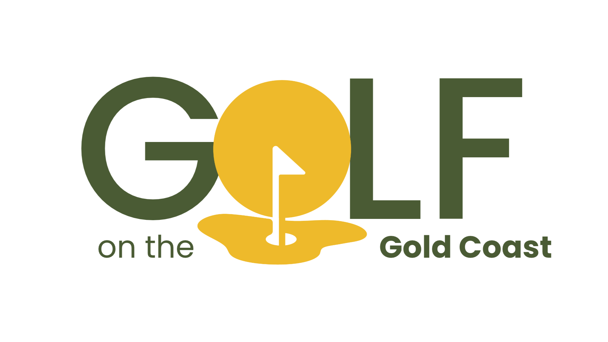

<p align="center">
  
</p>

<h1 align="center">Golf on the Gold Coast</h1>

<p align="center">
  <em>An 8-page, responsive HTML + CSS website design concept, intended to guide teens aged 13-17 who are visiting or live on the Gold Coast to a curated selection of local golf courses and driving ranges. </em>
</p>

<p align="center">
  
  
  
  
</p>

<p align="center">
  <a href="https://braydenh563.github.io/golf-on-the-gold-coast/"><strong>View the live site →</strong></a>
</p>


<!-- Add 1-2 screenshots here (desktop + mobile), e.g.
<p align="center">
  
</p>
-->

## About

Built for DXB111 Introduction to Web Design at QUT. The brief was to design and build a small, accessible, multi-page website for a chosen audience. This site helps golfers (from beginners to regulars) compare local courses and driving ranges and decide where to play.

## Pages

| Page | Description |
| --- | --- |
| Home | Overview and entry points to the rest of the site |
| Golf Courses | Course listings, linking to Parkwood and Boomerang Hills |
| Driving Ranges | Range listings, linking to Topgolf and KDV Sport |
| Individual venues | Dedicated pages for Parkwood, Boomerang Hills, Topgolf and KDV Sport |
| About | Background on the site |

## Built with

- HTML5 (semantic markup)
- CSS3: Flexbox, custom properties (CSS variables), and mobile-first media queries
- No frameworks or JavaScript

## Design

The design decisions (audience, colour, typography, layout and accessibility) are explained in the [design rationale](docs/design-rationale.pdf).

## Run locally

No build step. Clone the repo and open `index.html` in a browser:

```bash
git clone https://github.com/Braydenh563/golf-on-the-gold-coast.git
cd golf-on-the-gold-coast
```

## What I'd improve

- Add a booking or contact form
- Add a map of all venues
- Extend the layout with CSS Grid for the listing pages

## Licence

Code is released under the [MIT Licence](LICENSE). The written content, including the design rationale, is [CC BY 4.0](https://creativecommons.org/licenses/by/4.0/). Images belong to their respective owners (see below).

## References

### Photos

All photos are from [Unsplash](https://unsplash.com/) and used under the Unsplash licence.

- Anderson, A. (2021). *a couple of men standing on top of a lush green field* [Photograph of golfers on a coastal course]. Unsplash. Retrieved October 16, 2026, from https://unsplash.com/photos/6I0LxsA7Pd4
- Drew, P. (2021). *a man hitting a golf ball with a golf club* [Photograph of a golfer hitting a ball out of a bunker]. Unsplash. Retrieved October 16, 2026, from https://unsplash.com/photos/C5B3AMsBep8
- Hewines, M. (2019). *man playing golf during daytime* [Photograph of a golfer hitting from a Topgolf-style bay]. Unsplash. Retrieved October 16, 2026, from https://unsplash.com/photos/1r2UHeyODRY
- Nickerson, C. (2021). *a group of young women standing next to each other* [Photograph of a group of friends on a golf course]. Unsplash. Retrieved October 16, 2026, from https://unsplash.com/photos/U-z0q8ah6wQ
- Rosar, F. (2024). *A man standing on top of a green golf course* [Photograph of a golfer tossing a ball beside the flag]. Unsplash. Retrieved October 16, 2026, from https://unsplash.com/photos/PRIZylGN87Q
- Stenholm, D. (2022). *a fishing net on a field* [Photograph of a bucket of golf balls beside a club]. Unsplash. Retrieved October 16, 2026, from https://unsplash.com/photos/1oZamY4tkbw
- Wendler, B. (2024). *a view of a golf course from the green* [Photograph of a golf course fairway at sunset]. Unsplash. Retrieved October 16, 2026, from https://unsplash.com/photos/RI5g7U0kwpM

### Icons, fonts and maps

- Font Awesome. (2026). *Icons* (Version 4.7). Retrieved October 6, 2026, from https://fontawesome.com/v4/icons/
- Google. (2026). *Google Fonts*. Retrieved October 6, 2026, from https://fonts.google.com/
- Google. (2026). *Google Maps* [Interactive maps]. Retrieved October 18, 2026, from https://www.google.com/maps

### Venue information

<details>
<summary>Show all 17 venue sources</summary>

All retrieved October 18, 2026.

- Boomerang Hills. (2026). *Boomerang Hills: Golf course, putt putt, restaurant & bar*. https://boomeranghills.com.au/
- Boomerang Hills. (2026). *Golf course*. https://boomeranghills.com.au/golf-course/
- Boomerang Hills. (2026). *Putt putt course*. https://boomeranghills.com.au/putt-putt/
- Emerald Lakes Golf Club. (2026). *Driving range*. https://emeraldlakesgolf.com.au/golf/driving-range/
- Jones, M. (2026). *Boomerang Hills golf course*. Gold Coast Point. https://www.goldcoastpoint.com.au/attractions/boomerang-farm-golf-course/
- KDV Sport. (2026). *About*. https://kdvsport.com/about/
- KDV Sport. (2026). *Contact*. https://kdvsport.com/about/contact/
- KDV Sport. (2026). *Golf*. https://kdvsport.com/golf/
- KDV Sport. (2026). *Hit day or night at the best Gold Coast driving range*. https://kdvsport.com/golf/driving-range/
- KDV Sport. (2026). *No.1 private golf coaching lessons Gold Coast*. https://kdvsport.com/golf-academy/private-golf-coaching/
- Parkwood Village. (2026). *Parkwood golf club: 18 holes Gold Coast golf course*. https://theclubparkwood.com.au/pages/parkwood-golf-club
- Topgolf Gold Coast. (2026). *Contact Topgolf Gold Coast for enquiries and assistance*. https://topgolf.com.au/contact
- Topgolf Gold Coast. (2026). *Experience Topgolf Gold Coast: Beginner's guide*. https://topgolf.com.au/experience
- Topgolf Gold Coast. (2026). *Frequently asked questions (FAQ) at Topgolf Gold Coast*. https://topgolf.com.au/faq
- Topgolf Gold Coast. (2026). *Location and information for Topgolf Gold Coast*. https://topgolf.com.au/location-and-info
- Topgolf Gold Coast. (2026). *Pricing at Topgolf Gold Coast*. https://topgolf.com.au/pricing

</details>

## Author

Brayden Hoyle
